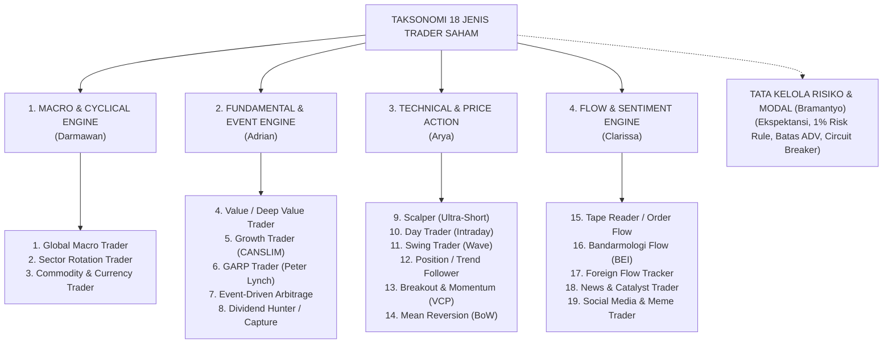
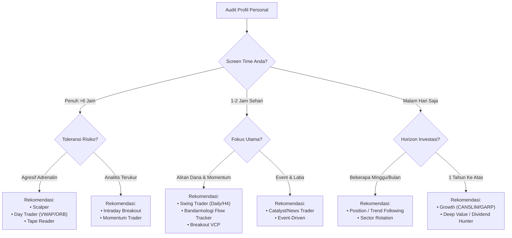

# PANDUAN LENGKAP & TAKSONOMI JENIS-JENIS TRADER SAHAM
## Riset Komprehensif, Dataset Kuantitatif, dan Analisis Multidimensi
**Tim Peneliti:** Tim Saham (Financial & Quantitative Research Team)  
**Lead Coordinator:** Richard (*Chief Investment Officer & Lead Portfolio Manager*)  
**Analis Spesialis:** Darmawan (*Macro*), Adrian (*Fundamental*), Arya (*Technical*), Clarissa (*Sentiment & Flow*), Bramantyo (*Risk*)  
**Tanggal Terbit:** September 2026 | Dokumen Resmi Portofolio

---

## DAFTAR ISI
1. [Prolog & Filosofi Trading Terpadu](#1-prolog--filosofi-trading-terpadu)
2. [Peta Arsitektur: 4 Klaster & 18 Tipe Trader](#2-peta-arsitektur-4-klaster--18-tipe-trader)
3. [Pembedahan Mendalam 18 Tipe Trader Saham](#3-pembedahan-mendalam-18-tipe-trader-saham)
   - [Klaster I: Macro & Cyclical Engine](#klaster-i-macro--cyclical-engine-darmawan)
   - [Klaster II: Fundamental & Event-Driven Engine](#klaster-ii-fundamental--event-driven-engine-adrian)
   - [Klaster III: Technical & Price Action Engine](#klaster-iii-technical--price-action-engine-arya)
   - [Klaster IV: Sentiment, Flow & Microstructure Engine](#klaster-iv-sentiment-flow--microstructure-engine-clarissa)
4. [Tabel Matriks Kuantitatif Komprehensif (18 Tipe Trader)](#4-tabel-matriks-kuantitatif-komprehensif-18-tipe-trader)
5. [Data Pemetaan Emiten Bursa Efek Indonesia (BEI) & Indikator Kunci](#5-data-pemetaan-emiten-bursa-efek-indonesia-bei--indikator-kunci)
6. [Data Kode Broker & Matriks Bandarmologi BEI](#6-data-kode-broker--matriks-bandarmologi-bei)
7. [Arsitektur Risiko & Fondasi Matematika Trading](#7-arsitektur-risiko--fondasi-matematika-trading-bramantyo)
   - [Matematika Ekspektansi Trading](#a-matematika-ekspektansi-trading)
   - [Tabel Probabilitas Losing Streak (10 Loss Beruntun)](#b-tabel-probabilitas-losing-streak-10-loss-beruntun)
   - [Keruntuhan Matematis Scalper di BEI Akibat Fee Friksi](#c-keruntuhan-matematis-scalper-di-bei-akibat-fee-friksi)
   - [Formula Position Sizing 1% Account Risk](#d-formula-position-sizing-1-account-risk)
   - [Batasan Likuiditas Average Daily Volume (ADV)](#e-batasan-likuiditas-average-daily-volume-adv)
   - [Bahaya Leverage, Margin Call & Jebakan Kunci ARB](#f-bahaya-leverage-margin-call--jebakan-kunci-arb)
   - [Protokol Personal Circuit Breaker](#g-protokol-personal-circuit-breaker)
8. [Panduan Self-Assessment: Menemukan DNA Trading Anda](#8-panduan-self-assessment-menemukan-dna-trading-anda)
9. [The "IHSG Hybrid Edge" & 10 Doktrin Emas CIO Richard](#9-the-ihsg-hybrid-edge--10-doktrin-emas-cio-richard)

---

## 1. PROLOG & FILOSOFI TRADING TERPADU

Pasar modal bukanlah arena tebak-tebakan acak (*random walk*), melainkan sistem dinamis kompleks yang digerakkan oleh interaksi likuiditas, psikologi massa, siklus ekonomi, dan nilai intrinsik korporasi. 

Sebagian besar pelaku pasar mengalami kegagalan konsistensi bukan karena minimnya indikator teknikal atau laporan keuangan, melainkan karena **ketidaksesuaian fundamental antara DNA personal trader (modal, ketersediaan waktu, toleransi psikologis) dengan gaya trading yang dipaksakan**.

Formula dasar profitabilitas portofolio institusional:

$$\text{Trading Edge} = (\text{Macro Regimes} \times \text{Fundamental Analysis} \times \text{Technical Timing} \times \text{Flow Tracking}) \times \text{Risk Governance}$$

Jika salah satu parameter analisis bergeser namun tata kelola risiko (*Risk Governance*) bernilai 0, maka seluruh hasil akhir niscaya bernilai 0.

---

## 2. PETA ARSITEKTUR: 4 KLASTER & 18 TIPE TRADER



---

## 3. PEMBEDAHAN MENDALAM 18 TIPE TRADER SAHAM

### KLASTER I: MACRO & CYCLICAL ENGINE (Darmawan)

#### 1. Global Macro Trader
* **Prinsip Utama:** Alokasi modal berbasis *top-down*. Arus likuiditas makro global (*the tide*) jauh lebih menentukan daripada perahu spesifik emiten (*the boats*).
* **Variabel Analisis:** Kebijakan suku bunga bank sentral (Fed Funds Rate, BI-Rate), kurva imbal hasil (*yield curve inversion & steepening*), inflasi riil, indeks dolar (DXY), dan pasokan likuiditas uang beredar (M2).
* **Horizon & Aset:** 3 bulan hingga beberapa tahun; fokus pada saham *Big Cap Index Movers* (LQ45/IDX30), obligasi negara (SBN), dan ETF indeks (EIDO).
* **Kelebihan & Kelemahan:** Terhindar dari krisis pasar sistemik dan kebal derau (*noise*) harian; kelemahannya mengabaikan peluang *micro-alpha* pada saham lapis dua dan tiga yang melesat terlepas dari kondisi ekonomi.

#### 2. Sector Rotation / Cyclical Trader
* **Prinsip Utama:** Bergerak mengantisipasi 4 fase jam siklus bisnis (*Business Cycle Clock*):
  - **Early Cycle (Pemulihan / Suku Bunga Rendah):** Masuk ke Sektor Perbankan (`BBCA, BBRI, BMRI, BBNI`) dan Properti (`CTRA, BSDE, SMRA`).
  - **Mid Cycle (Ekspansi Puncak):** Industri manufaktur, konsumsi siklikal, otomotif (`ASII`), dan telekomunikasi/teknologi (`TLKM, GOTO`).
  - **Late Cycle (Overheating / Inflasi Puncak):** Sektor Komoditas Energi & Logam Tambang (`ADRO, PTBA, MEDC, ANTM`).
  - **Recession (Kontraksi Ekonomi):** Sektor Defensif seperti Consumer Staples (`ICBP, INDF, MYOR`), Farmasi (`KLBF`), dan Kas.
* **Kelebihan & Kelemahan:** Portofolio selalu berada di sektor yang mencatatkan akselerasi pertumbuhan laba tertinggi; membutuhkan kesabaran menunggu konfirmasi rotasi sektor.

#### 3. Commodity & Currency-Driven Stock Trader
* **Prinsip Utama:** Mengeksploitasi ketergantungan bursa (khususnya IHSG) terhadap harga acuan komoditas dunia (Newcastle Coal, MDEX CPO, LME Nickel, Brent Oil, Comex Gold) dan nilai tukar USD/IDR.
* **Mekanisme *Operating Leverage*:** Biaya operasional penambangan bersifat tetap (*fixed cost*). Kenaikan harga komoditas acuan +30% dapat mendongkrak margin operasi dan laba bersih emiten hingga +100%+. Depresiasi Rupiah menguntungkan emiten eksportir komoditas (pendapatan USD, biaya operasional IDR), namun memukul emiten dengan bahan baku impor tinggi (`CPIN, JPFA, KLBF`) atau utang valas besar.

---

### KLASTER II: FUNDAMENTAL & EVENT-DRIVEN ENGINE (Adrian)

#### 4. Value / Deep Value Trader
* **Prinsip Utama:** Filosofi Benjamin Graham & Seth Klarman. Membeli saham yang terdiskon ekstrem di bawah nilai likuidasi atau nilai buku wajar akibat kepanikan pasar temporer.
* **Metrik Kunci:** Net Current Asset Value ($\text{NCAV} = \text{Aset Lancar} - \text{Total Liabilitas}$), PBV < 0.5x, PER single digit, EV/EBITDA rendah, dan FCF Yield > 10–15%.
* **Kelebihan & Risiko:** *Margin of safety* tebal dengan risiko kerugian permanen modal yang rendah; namun berisiko terjebak **Value Trap** (saham murah yang terus anjlok karena tata kelola buruk atau disrupsi struktural).

#### 5. Growth Trader (CANSLIM Framework)
* **Prinsip Utama:** *"Buy high and sell much higher"* (William J. O'Neil). Berburu emiten pemimpin industri (*market leaders*) dengan akselerasi laba kuartalan (EPS) dan pendapatan eksplosif (>25% YoY).
* **Framework CANSLIM:** C (Current EPS >25%), A (Annual EPS CAGR 3–5 tahun >25%), N (New Catalyst / Breakout 52-Week High), S (Supply/Demand float terkendali), L (Leader vs Laggard), I (Institutional Sponsorship), M (Market Direction searah IHSG).
* **Kelebihan & Risiko:** Potensi mencetak *multibagger* terbesar; namun rentan kompresi valuasi instan jika laba kuartalan meleset dari konsensus analis.

#### 6. GARP Trader (Growth at a Reasonable Price)
* **Prinsip Utama:** Filosofi Peter Lynch. Titik temu antara Value dan Growth. Menolak membeli saham murah tanpa masa depan, namun enggan membayar valuasi saham *growth* yang tidak masuk akal.
* **Metrik Kunci:** Rasio PEG (*Price/Earnings-to-Growth*):
  $$\text{PEG Ratio} = \frac{\text{PER}}{\text{Laju Pertumbuhan EPS (\%)}} \le 1.0$$
* **Kelebihan & Risiko:** Profil imbal hasil risiko paling stabil untuk portofolio jangka menengah-panjang; tantangannya adalah kesulitan menemukan saham GARP di masa *bull market* euforia.

#### 7. Event-Driven & Special Situations Trader
* **Prinsip Utama:** Menghasilkan *market-neutral alpha* (imbal hasil yang tidak berkorelasi dengan pergerakan IHSG) dengan mengeksploitasi selisih harga dari aksi korporasi diskrit:
  - **Tender Offer Arbitrage (MTO):** Menghitung *spread* harga pasar terhadap harga penawaran tender wajib pasca-akuisisi pengendali baru.
  - **Rights Issue (HMETD):** Menganalisis valuasi harga tebus (*exercise price*), komitmen pembeli siaga (*standby buyer*), dan efek dilusi.
  - **Spin-Off & SOTP:** Membuka diskon konglomerasi melalui valuasi *Sum-of-the-Parts*.
* **Risiko Terbesar:** *Deal break* (pembatalan transaksi aksi korporasi oleh regulator atau penolakan RUPS).

#### 8. Dividend Hunter & Dividend Capture Trader
* **Dua Pendekatan:**
  1. *Dividend Compounder:* Mengoleksi emiten dengan dividen konsisten dan bertumbuh (*dividend aristocrats*) untuk efek bunga berbunga jangka panjang.
  2. *Dividend Capture (Taktikal):* Masuk menjelang penutupan *Cum-Date*, mengunci hak dividen tunai, dan keluar saat harga pulih di sesi pasca *Ex-Date*.
* **Bahaya Laten:** **Dividend Trap** (penurunan harga pada pagi hari *Ex-Date* jauh melebihi nilai dividen yang didapat, kerap terjadi pada emiten komoditas siklikal di puncak laba).

---

### KLASTER III: TECHNICAL & PRICE ACTION ENGINE (Arya)

#### 9. Scalper (Ultra-Short Term)
* **Timeframe & Holding:** Detik hingga beberapa menit ($m1$ s/d $m5$, *tick chart*). Wajib menutup posisi sebelum penutupan sesi bursa (*Zero Overnight Risk*).
* **Metode Operasional:** Mengambil margin profit kecil (0.5% – 2.0%) dengan volume frekuensi tinggi (puluhan transaksi per hari). Mengandalkan **Depth of Market (Level 2 DOM)**, *Time & Sales*, dan VWAP intra-menit.
* **Tantangan BEI:** Beban fee transaksi round-trip BEI (~0.40%) memotong porsi keuntungan secara signifikan; menuntut konsentrasi tingkat tinggi dan rentan kelelahan mental (*decision fatigue*).

#### 10. Day Trader / Intraday Trader
* **Timeframe & Holding:** 15 menit hingga beberapa jam dalam satu hari bursa ($m5, m15$, dan $H1$).
* **Setup Andalan:** *Opening Range Breakout* (ORB 15–30 menit pertama), *VWAP Pullback & Rejection*, serta memanfaatkan likuiditas Sesi 1 (09.00–10.30 WIB) dan Sesi 2 (14.30–15.30 WIB).
* **Kelebihan:** Tidur nyenyak tanpa terpapar risiko gap down bursa global; tantangannya adalah disiplin menahan diri dari godaan *overtrading* dan *revenge trading*.

#### 11. Swing Trader (Wave & Cycle Trader)
* **Timeframe & Holding:** 3 hari hingga 4 minggu (Daily dikonfirmasi dengan $H4$).
* **Setup Andalan:** Menangkap satu gelombang impuls (*impulse swing leg*) dari pembentukan *Swing Low* ke *Swing High*. Memanfaatkan *Support/Resistance Flip*, *Fibonacci Retracement* (50.0% – 61.8%), *Wyckoff Spring/LPS*, dan EMA 20/50 Daily.
* **Kelebihan:** Rasio *Return-to-Effort* terbaik untuk pelaku pasar yang memiliki pekerjaan utama (cukup analisis malam hari / EOD); memiliki eksposur terhadap risiko *overnight gap*.

#### 12. Position Trader / Trend Follower
* **Timeframe & Holding:** Beberapa minggu, bulan, hingga tahunan (Weekly dan Daily).
* **Filosofi:** *"Cut losses short, let winners run."* Mengendarai tren sekuler besar (*Stage 2 Advancing Phase* Stan Weinstein) di atas garis SMA 200 / MA 30-minggu. Menggunakan teknik piramida (*scaling-in*) seiring terbentuknya harga tertinggi baru.
* **Kelebihan & Kelemahan:** Menghasilkan potensi cuan ratusan persen dengan frekuensi transaksi sangat hemat; namun harus tahan menghadapi *floating drawdown* (koreksi 10%–20% di tengah tren naik).

#### 13. Breakout & Momentum Trader
* **Setup Andalan:** *"Buy High, Sell Much Higher"*. Membeli saat harga menembus level resistensi kunci, formasi konsolidasi menyempit (*Volatility Contraction Pattern / VCP* Mark Minervini), atau *All-Time High (ATH)* dengan lonjakan volume $\ge 150\% - 200\%$ di atas rata-rata 20 hari.
* **Risiko Terbesar:** Jebakan penembusan palsu (*Bull Trap / False Breakout*).

#### 14. Mean Reversion Trader (Buy on Weakness)
* **Setup Andalan:** *"Buy Low, Sell at Mean Equilibrium"*. Memanfaatkan efek karet gelang (*rubber band effect*): harga yang menyimpang ekstrem dari nilai wajarnya akan tertarik kembali ke titik rata-rata.
* **Indikator:** RSI ekstrem oversold (<25-30) dengan *Bullish Divergence*, pengujian batas bawah Bollinger Bands (2 SD), dan konfluensi Fibonacci Support.
* **Risiko Terbesar:** Terkena fenomena "menangkap pisau jatuh" (*falling knife*) jika emiten mengalami kerusakan fundamental struktural.

---

### KLASTER IV: SENTIMENT, FLOW & MICROSTRUCTURE ENGINE (Clarissa)

#### 15. Tape Reader & Order Flow Trader
* **Fokus Mikrostruktur:** Membaca interaksi dinamis antara antrean limit pasif (*Level 2 Order Book Depth*) dan transaksi agresif seketika (*Time & Sales Tape*).
* **Keahlian Khusus:** 
  - Mendeteksi *Fake Bids / Spoofing* (antrean beli tebal yang dipasang untuk memancing ritel pasang di atasnya, lalu dicabut kilat saat harga mendekat).
  - Mendeteksi *Iceberg Orders* (institusi besar menyembunyikan lot pesanan aslinya dengan memunculkan pesanan-pesanan kecil bertahap secara otomatis).
  - Mengamati dominasi inisiator agresif: Agresor Beli (HAKA) vs Agresor Jual (HAKI).

#### 16. Bandarmologi & Smart Money Flow Trader (Khas IHSG)
* **Struktur Pasar BEI:** Struktur kepemilikan saham beredar (*free float*) yang relatif terkonsentrasi melahirkan dominasi entitas *market maker / sindikat* penggerak harga di saham lapis dua dan tiga.
* **Metodologi Analisis:**
  - **Broker Summary (Broksum) EOD:** Memeriksa konsentrasi akumulasi (CR3, CR5) – jika Top 3 broker menguasai >70% volume beli sementara penjual tersebar di puluhan broker ritel (YP, PD, XC, NI), terkonfirmasi terjadi *Big Accumulation*.
  - **Bandar VWAP:** Menghitung rata-rata harga modal bandar selama fase konsolidasi untuk dijadikan level *Strong Support*.
  - **Siklus 4 Fase Wyckoff:** *Silent Accumulation $\rightarrow$ Mark-Up $\rightarrow$ Distribution (saat ritel euforia) $\rightarrow$ Mark-Down (ARB beruntun)*.

#### 17. Foreign Flow Tracker
* **Karakteristik Aliran Dana:** Investor institusi global (BlackRock, Vanguard, sovereign funds) mendominasi saham perbankan dan *blue chips* (BBCA, BBRI, BMRI, BBNI, TLKM, ASII) yang memiliki korelasi linear >0.75 terhadap arah IHSG.
* **Katalis & Siklus:** Digerakkan oleh indeks dolar (DXY), yield spread obligasi (SBN 10Y vs US Treasury 10Y), serta siklus *Rebalancing Indeks Global (MSCI & FTSE)* yang memicu lonjakan transaksi triliunan rupiah dalam hitungan detik pada sesi *Pre-Closing Auction*.

#### 18. News & Catalyst Trader
* **Fokus Operasional:** Bertransaksi berdasarkan kecepatan memproses dan merespons berita material: kejutan laba (*earnings surprise*), dividen istimewa, kontrak baru, atau regulasi sektoral.
* **Aksioma Pasar:** *"Buy the rumor, sell the news."* Mengukur ekspektasi konsensus vs realitas rilis berita; ritel yang terlambat sering dijadikan *exit liquidity*.

#### 19. Social Media / Retail Sentiment / Meme Trader
* **Fokus Operasional:** Memantau gelombang euforia di komunitas ritel (Stockbit Stream, grup VIP Telegram, FinTwitter/X, TikTok).
* **Anatomi Pom-Pom:** Akumulasi saham tidur tak likuid $\rightarrow$ Rekayasa narasi target fiktif $\rightarrow$ HAKA pancingan $\rightarrow$ Publikasi broadcast medsos $\rightarrow$ Guyur antrean bid ritel yang terkena FOMO.
* **Risiko Ekstrem:** Saham gorengan rawan disuspensi bursa (UMA) atau didegradasi ke Papan Pemantauan Khusus (*Full Call Auction* / FCA).

---

## 4. TABEL MATRIKS KUANTITATIF KOMPREHENSIF (18 TIPE TRADER)

| No | Tipe Trader Saham | Holding Period | Timeframe Acuan | Target Win Rate (%) | Min RRR Target | Target Return / Trade | Batas Stop Loss | Biaya Friksi (Fee & Tax BEI) | Skala Modal Ideal | Max Drawdown Tolerable |
|:--:|:---|:---|:---|:---:|:---:|:---:|:---:|:---:|:---|:---:|
| 1 | **Global Macro Trader** | 3 Bln – 2 Thn | Weekly, Monthly | 50% – 60% | 1 : 2.5 | 20% – 60% | 8% – 12% | Terabaikan (<0.5%) | > Rp 500 Juta | 10% – 15% |
| 2 | **Sector Rotation Trader** | 1 – 6 Bulan | Daily, Weekly | 55% – 65% | 1 : 2.0 | 15% – 35% | 6% – 10% | Sangat Rendah (<1%) | > Rp 100 Juta | 12% – 18% |
| 3 | **Commodity/FX Stock Trader** | 2 Mgg – 6 Bln | Daily, H4 | 45% – 55% | 1 : 3.0 | 20% – 50% | 5% – 8% | Rendah (<1.5%) | > Rp 50 Juta | 15% – 25% |
| 4 | **Deep Value / Net-Net** | 1 – 3 Tahun | Monthly, Lapkeu | 60% – 70% | 1 : 3.0 | 40% – 100%+ | Berbasis Aset/NCAV | Terabaikan (<0.5%) | Fleksibel | 10% – 15% |
| 5 | **Growth Trader (CANSLIM)** | 2 – 12 Bulan | Daily, Weekly | 40% – 50% | 1 : 3 s/d 1 : 5 | 25% – 100%+ | 7% – 8% (Ketat) | Rendah (<1.5%) | > Rp 50 Juta | 15% – 25% |
| 6 | **GARP Trader (Peter Lynch)** | 6 – 24 Bulan | Weekly, Lapkeu | 55% – 65% | 1 : 2.5 | 20% – 45% | 8% – 10% | Sangat Rendah (<1%) | > Rp 25 Juta | 10% – 15% |
| 7 | **Event-Driven Arbitrage** | Hari – Bulan | Jadwal Corporate Action | 70% – 85% | 1 : 1.5 | 5% – 15% (IRR tinggi) | Biner / Spread | Rendah (<2%) | > Rp 100 Juta | Biner / Deal Break |
| 8 | **Dividend Capture** | 2 Hari – 3 Minggu | Cum-Date s/d Ex-Date | 75% – 85% | 1 : 1.2 | 8% – 15% Yield | Filter Ex-Date Trap | Rendah (<1%) | > Rp 100 Juta | Rendah (Awas Trap) |
| 9 | **Scalper (Ultra-Short)** | Detik – Menit | Detik, m1, m3, m5 | 65% – 80% | 1 : 0.8 s/d 1 : 1 | 0.5% – 2.0% | 0.4% – 0.8% | **KRITIKAL FATAL (>30% Gross)** | Rp 10 – 100 Juta | Ekstrem / Burnout |
| 10 | **Day Trader (Intraday)** | 15 Mnt – 1 Sesi | m5, m15, H1 | 50% – 60% | 1 : 1.5 s/d 1 : 2.5 | 2.0% – 6.0% | 1.0% – 2.0% | Signifikan (5–15% Gross) | Rp 25 – 200 Juta | 15% – 20% |
| 11 | **Swing Trader (Wave)** | 3 Hari – 4 Minggu | H4, Daily | 45% – 55% | 1 : 2 s/d 1 : 3.5 | 8% – 25% | 3% – 5% | Rendah (<2%) | Fleksibel | 10% – 15% |
| 12 | **Position / Trend Follower** | Bulan – Tahunan | Daily, Weekly | 35% – 45% | 1 : 4 s/d 1 : 10+ | 30% – 200%+ | 5% – 10% (Trailing) | Sangat Rendah (<0.5%) | > Rp 100 Juta | 20% – 30% |
| 13 | **Breakout & Momentum (VCP)** | Hari – Minggu | Daily, H1 | 40% – 50% | 1 : 2.5 s/d 1 : 4 | 15% – 40% | 3% – 5% | Rendah (<2%) | > Rp 50 Juta | 15% – 20% |
| 14 | **Mean Reversion (BoW)** | 1 – 5 Hari | Daily, H4 | 60% – 70% | 1 : 1.2 s/d 1 : 2 | 5% – 12% | 2% – 4% | Rendah (<2%) | Fleksibel | 12% – 18% |
| 15 | **Tape Reader / Order Flow** | Detik – Jam | DOM Level 2, Tape | 60% – 70% | 1 : 1 s/d 1 : 1.5 | 1.0% – 4.0% | 0.8% – 1.5% | Tinggi (15–25% Gross) | < Rp 100 Juta | Tinggi (Slippage) |
| 16 | **Bandarmologi Flow Trader** | Hari – Minggu | EOD Broksum, Daily | 50% – 60% | 1 : 2 s/d 1 : 3 | 10% – 30% | 4% – 6% | Rendah (<2%) | > Rp 50 Juta | Tinggi (Manipulasi) |
| 17 | **Foreign Flow Tracker** | Minggu – Bulan | Daily, Flow Net Buy | 55% – 65% | 1 : 2 s/d 1 : 3 | 12% – 30% | 4% – 6% | Rendah (<1%) | > Rp 250 Juta | Rendah – Sedang |
| 18 | **News & Catalyst Trader** | Menit – Hari | Breaking News, m15 | 50% – 60% | 1 : 2 s/d 1 : 4 | 5% – 20% | 3% – 5% | Moderat | Fleksibel | Ekstrem (Whipsaw) |

---

## 5. DATA PEMETAAN EMITEN BURSA EFEK INDONESIA (BEI) & INDIKATOR KUNCI

| Kategori Trader | Emiten BEI Khas / Target Universe | Indikator Kunci & Metrik Analisis | Tools & Software Utama |
|:---|:---|:---|:---|
| **Global Macro** | BBCA, BBRI, BMRI, BBNI, TLKM, ASII, SBN, ETF EIDO | US 10Y Treasury, SUN 10Y Yield, DXY, M2 Liquidity, Fed Dot Plot | TradingView, Bloomberg Terminal, Fred St. Louis |
| **Sector Rotation** | • Early: BBCA, CTRA, BSDE<br>• Mid: ASII, UNTR, TLKM<br>• Late: ADRO, PTBA, MEDC<br>• Recession: ICBP, INDF, KLBF | Relative Strength Index Sektoral, Business Cycle Clock, Output Gap | Stockbit Screener, TradingView, RTI Business |
| **Commodity/FX** | ADRO, PTBA, ITMG, MEDC, ANTM, INCO, MDKA, TAPG, LSIP, INKP | Harga Acuan: Newcastle Coal, MDEX CPO, LME Nickel, Brent Oil, USD/IDR | Investing.com Commodities, TradingView, Reuters |
| **Deep Value** | Saham PBV < 0.5x, PER < 5x, Cash > Market Cap (Net-Net Graham) | NCAV ($Aset Lancar - Total Utang$), EV/EBITDA, Net Debt/EBITDA, FCF Yield | Laporan Keuangan IDX, Stockbit Screener, Excel Model |
| **Growth (CANSLIM)** | Emiten New 52-Week High, Laba EPS >25% YoY, Revenue Growth >20% | EPS QoQ/YoY, Annual CAGR >25%, ROE >17%, RS Rating >80 | IBD MarketSmith, Stockbit Screener, TradingView |
| **GARP (Peter Lynch)** | Emiten Mid-Cap bertumbuh 15–25% dengan PER 10–15x | PEG Ratio $\le 1.0$, ROIC > WACC, Sustainable Growth Rate ($SGR$) | Stockbit Screener, Simply Wall St, Financial Ratios |
| **Event-Driven** | Saham MTO (Tender Offer), Rights Issue, Spin-Off, Delisting | Arbitrage Spread %, Harga Tebus HMETD, Standby Buyer, SOTP Valuation | Keterbukaan Informasi BEI (IDX Announcements), Prospektus |
| **Dividend Hunter** | ITMG, PTBA, ADRO, MPMX, TOTL, BJBR, BJTM, BBCA, BBRI | Dividend Yield %, FCF Coverage Ratio (>1.2x), Dividend Payout Ratio (DPR) | Jadwal Dividen RTI Business, KSEI Corporate Action |
| **Scalper** | Saham Paling Aktif Fraksi Kecil (<Rp 1.000) & Top Volatilitas | Order Book DOM Level 2, Time & Sales, VWAP intra-menit, Delta Volume | Neo HOST Mirae, IPOT Ultimate, Ajaib Pro Desktop |
| **Day Trader** | Top Gainer Harian, Saham Breakout Sesi 1, Saham Komoditas Aktif | Opening Range Breakout (ORB 15/30m), VWAP Pullback, EMA 9/21 m5 | TradingView (Pro), Broker Platform Desktop |
| **Swing Trader** | Indeks IDX80, Komponen Komoditas, Blue Chip Konsolidasi | S/R Flip, Fibonacci Retracement 50%-61.8%, Wyckoff Spring, EMA 20/50 Daily | TradingView, ChartNexus, Amibroker |
| **Trend Follower** | Saham Uptrend Konsisten di atas SMA 200 (Stage 2 Weinstein) | SMA 50, SMA 150, SMA 200, Donchian Channel, Chandelier ATR Exit | TradingView Pine Script, Amibroker AFL |
| **Breakout / VCP** | Saham membentuk kontraksi volatilitas (VCP 2-4 kontraksi) dekat ATH | Volatility Contraction Pattern (VCP), Volume vs SMA 20 Vol (>200%) | TradingView Screener, Finviz (US), Stockbit Pro |
| **Mean Reversion** | Blue Chip terpukul panik sesaat / Flash Crash | RSI < 25-30, Lower Bollinger Bands (2 SD), Support Historical | TradingView, MetaTrader, Amibroker |
| **Tape Reader** | Saham Lapis 2 & 3 Teraktif Volume | DOM Level 2 (Deteksi Fake Bid/Spoofing, Iceberg Order, HAKA/HAKI) | Direct Market Access (DMA) Trading Terminal |
| **Bandarmologi** | Saham Lapis 2/3 dengan Akumulasi Terkonsentrasi | Broker Summary EOD: Concentration Ratio (CR3/CR5 >70%), Bandar VWAP | Datafeed Broksum BEI, D-Bandar, Tools Bandarmologi |
| **Foreign Flow** | BBCA, BBRI, BMRI, BBNI, TLKM, ASII, AMMN, ADRO | Foreign Net Buy/Sell (Kumulatif 20-60 hari), Rebalancing MSCI & FTSE | RTI Foreign Flow, Dataflow Pasar Reguler BEI |
| **News / Catalyst** | Saham rilis lapkeu dadakan, penandatanganan MoU, izin tambang RKAB | Kecepatan Respon Berita, Earnings Surprise vs Konsensus Analis | Bloomberg Wire, CNBC, Bisnis.com, Keterbukaan Informasi BEI |

---

## 6. DATA KODE BROKER & MATRIKS BANDARMOLOGI BEI

```text
1. BROKER INSTITUSI ASING (Foreign Flow Drivers)
   - AK (UBS Sekuritas)
   - BK (J.P. Morgan Sekuritas)
   - CS (Credit Suisse / KGI)
   - KZ (CLSA Sekuritas)
   - RX (Macquarie Sekuritas)
   - ZP (Maybank Sekuritas - Foreign Desk)
   - CG (Citigroup Sekuritas)
   → Ciri: Net buy akumulasi multi-minggu pada Big Caps (BBCA, BBRI, TLKM, ASII), tidak scalping.

2. BROKER INSTITUSI DOMESTIK & ASURANSI/DAPEN
   - CC (Mandiri Sekuritas - Institusi)
   - NI (BNI Sekuritas - Institusi)
   - LG (Trimegah Sekuritas - Desk Institusi)
   - OD (BRI Danareksa Sekuritas)
   → Ciri: Akumulasi saham BUMN, eksekusi reksadana/asuransi/dana pensiun.

3. BROKER OPERATOR LOKAL & SIKLIKAL (Market Maker / Bandar Lapis 2 & 3)
   - YU (CGS International)
   - PD (Indo Premier - Desk Khusus)
   - CD (Mega Capital)
   - GR (Panin Sekuritas - Desk Private)
   - SH (Shinhan Sekuritas)
   → Ciri: Pengendali likuiditas saham lapis dua & tiga, crossing di Pasar Negosiasi (NG).

4. BROKER RITEL MURNI (Retail Herd / The Dumb Money)
   - YP (Mirae Asset Sekuritas - Ritel Terbesar)
   - PD (Indo Premier IPOT - Ritel Online)
   - XC (Ajaib Sekuritas - Ritel Pemula & Gen-Z)
   - XL (Stockbit Sekuritas - Komunitas Ritel)
   - NI (BNI Sekuritas - BIONS Online)
   → Aturan Broksum:
     * Top Buyer = AK, BK, KZ, RX  |  Top Seller = YP, PD, XC  => BIG ACCUMULATION (Sangat Bullish)
     * Top Buyer = YP, PD, XC, NI  |  Top Seller = Asing/Bandar => BIG DISTRIBUTION (Sinyal Bahaya / Nyangkut)
```

---

## 7. ARSITEKTUR RISIKO & FONDASI MATEMATIKA TRADING (Bramantyo)

### A. Matematika Ekspektansi Trading
Formula matematis dasar yang menentukan apakah akun trading Anda akan bertumbuh atau hancur dalam jangka panjang:

$$E = (W \times R_{\text{win}}) - (L \times R_{\text{loss}})$$

Dimana:
* $W$ = *Win Rate* (desimal)
* $L$ = *Loss Rate* ($1 - W$)
* $R_{\text{win}}$ = Rata-rata persentase keuntungan saat menang
* $R_{\text{loss}}$ = Rata-rata persentase kerugian saat kalah

```text
Simulasi Ekspektansi:
Skenario Scalper Ceroboh: Win Rate 80%, Avg Win 1%, Avg Loss 5%
E = (0.80 x 1%) - (0.20 x 5%) = 0.8% - 1.0% = -0.2% (Ekspektansi Negatif -> Niscaya Bangkrut!)

Skenario Trend Follower: Win Rate 40%, Avg Win 15%, Avg Loss 4%
E = (0.40 x 15%) - (0.60 x 4%) = 6.0% - 2.4% = +3.6% (Ekspektansi Positif -> Akumulasi Kekayaan)
```

### B. Tabel Probabilitas Losing Streak (10 Loss Beruntun)
Dari sampel 500 kali transaksi dengan Win Rate 50%, probabilitas terjadinya rentetan 7 hingga 10 kali kekalahan beruntun (*consecutive losses*) mendekati **100%**. Tabel ini membuktikan mengapa membatasi risiko per trade adalah mutlak:

| Risk per Trade ($R\%$) | Drawdown 5 Loss Beruntun | Drawdown 10 Loss Beruntun | Sisa Modal Pasca 10 Loss | Gain Diperlukan untuk Impas |
|:---:|:---:|:---:|:---:|:---:|
| **0.5%** | -2.48% | -4.89% | Rp 95.110.000 | **+5.14%** (Sangat Aman) |
| **1.0%** | **-4.90%** | **-9.56%** | **Rp 90.440.000** | **+10.57%** (Standar Emas Portofolio) |
| **2.0%** | -9.61% | -18.29% | Rp 81.710.000 | **+22.38%** (Batas Maksimal Toleransi) |
| **5.0%** | -22.62% | -40.13% | Rp 59.870.000 | **+67.03%** (Spiral Kehancuran Akun) |
| **10.0%** | -40.95% | -65.13% | Rp 34.870.000 | **+186.78%** (Kebangkrutan Total) |

### C. Keruntuhan Matematis Scalper di BEI Akibat Fee Friksi
* Biaya transaksi BEI: Beli ~0.15%, Jual ~0.25% (Total round-trip $\approx 0.40\%$).
* Saham fraksi Rp 500 (1 tick = Rp 2 atau 0.40%):
  - Target TP: 2 tick = $+0.80\%$
  - Target SL: 1 tick = $-0.40\%$
  - RRR Teoritis: $2 : 1$
* **Kenyataan Net Pasca Fee Transaksi:**
  - Net Gain = $+0.80\% - 0.40\% = \mathbf{+0.40\%}$
  - Net Loss = $-0.40\% - 0.40\% = \mathbf{-0.80\%}$
  - **Efektif RRR Berbalik 180 Derajat:** Menjadi **$1 : 2$ (Inverted RRR)**!
  - Break-Even Win Rate ($WR_{\text{BE}}$) yang dibutuhkan:
    $$WR_{\text{BE}} = \frac{0.80\%}{0.40\% + 0.80\%} = \mathbf{66.7\%}$$
* **Konsekuensi:** Jika Win Rate scalper di BEI berada di angka 60%, akun tersebut dipastikan **bangkrut secara matematis (*sure ruin*)** karena terkuras oleh beban komisi bursa.

### D. Formula Position Sizing 1% Account Risk
$$\text{Maksimum Risiko Modal (IDR)} = \text{Total Portofolio} \times 1\%$$
$$\text{Maks Lembar Saham} = \frac{\text{Maksimum Risiko Modal (IDR)}}{|\text{Harga Beli (Entry)} - \text{Harga Stop Loss}|}$$
$$\text{Maks Lot} = \left\lfloor \frac{\text{Maks Lembar Saham}}{100} \right\rfloor$$

### E. Batasan Likuiditas Average Daily Volume (ADV)
* Total nilai posisi Anda pada satu emiten **DILARANG melebihi 5% sampai 10% dari ADV 20-hari** saham tersebut.
* Jika melanggar, Anda tidak dapat keluar dari saham saat terjadi kepanikan tanpa membanting harga pasar ke batas *Auto Rejection Bawah (ARB)*.

### F. Bahaya Leverage, Margin Call & Jebakan Kunci ARB
* Di BEI, saat saham mengalami penurunan ekstrem dan terkunci pada *Auto Rejection Bawah (ARB)*, antrean jual jutaan lot menumpuk di harga terendah tanpa ada penawar (*zero bid*).
* Dalam kondisi ini, **Stop Loss tidak dapat tereksekusi dan Forced Sell broker macet**, memicu risiko saldo menjadi **negatif (berutang tunai ke sekuritas)**.
* Kebijakan CRO: **Dilarang keras menginapkan posisi ber-margin (*overnight margin*)**.

### G. Protokol Personal Circuit Breaker
* **Daily Drawdown Limit (-2% s/d -3%):** Jika portofolio turun 2-3% dalam satu hari bursa, terminal trading **WAJIB DIMATIKAN**. Dilarang membuka posisi baru hingga esok hari.
* **Consecutive Loss Rule:** Jika mengalami 3 kali *loss* berturut-turut di hari yang sama, segera berhenti untuk memutus siklus emosi dendam (*revenge trading / tilt*).

---

## 8. PANDUAN SELF-ASSESSMENT: MENEMUKAN DNA TRADING ANDA



### 3 Aturan Diagnostik Utama CIO Richard:
1. **Bagi Karyawan Kantor / Profesional Penuh Waktu (Screen Time Malam Hari):**
   * **DILARANG:** Menjadi Scalper atau Day Trader.
   * **REKOMENDASI:** Jadilah **Swing Trader (EOD Chart)** atau **GARP/CANSLIM Position Trader** dengan memanfaatkan fitur *Automatic Order / Good-Til-Cancelled (GTC) Stop Loss*.
2. **Bagi Pemilik Modal di Bawah Rp 25 Juta:**
   * **HINDARI:** Terlalu mendiversifikasi portofolio seperti reksa dana (memegang 15–20 saham).
   * **REKOMENDASI:** Fokuskan modal pada 2 hingga 3 ide terbaik (*high conviction*) menggunakan metode **Swing Trading Breakout (VCP)** atau **Growth CANSLIM** untuk mempercepat penggulungan modal (*capital compounding*).
3. **Bagi Pemilik Modal di Atas Rp 1 Miliar:**
   * **HINDARI:** Bertransaksi agresif di saham lapis tiga (*small cap / gorengan*) yang tidak memiliki likuiditas keluar.
   * **REKOMENDASI:** Terapkan strategi **Foreign Flow Tracking**, **Sector Rotation**, atau **Dividend/Value Investing** pada saham LQ45/IDX80 dengan ukuran lot yang terukur terhadap ADV pasar.

---

## 9. THE "IHSG HYBRID EDGE" & 10 DOKTRIN EMAS CIO RICHARD

$$\begin{aligned}
\text{Rezim Makro Sektoral (Darmawan)} &\longrightarrow \text{Screening Fundamental Laba (Adrian)} \\
&\longrightarrow \text{Validasi Akumulasi Bandar/Asing (Clarissa)} \\
&\longrightarrow \text{Presisi Timing Entry Teknikal (Arya)} \\
&\longrightarrow \text{Pengawalan Position Sizing 1\% Risk (Bramantyo)}
\end{aligned}$$

### 10 Doktrin Emas Portofolio:
1. **Ketahui DNA Anda:** Ketidakcocokan gaya trading dengan kepribadian adalah jaminan kegagalan 100%.
2. **Proteksi Modal Pokok (*Capital Preservation*):** Modal adalah amunisi. Jika amunisi habis, permainan berakhir.
3. **Patuhi Stop Loss Tanpa Kompromi:** Kerugian 10% hanya butuh kenaikan 11% untuk impas; kerugian 50% membutuhkan kenaikan 100% hanya untuk kembali modal awal.
4. **Hormati Likuiditas Pasar:** Jangan pernah membeli saham yang Anda tidak tahu cara menjualnya saat terjadi kepanikan.
5. **Jangan Menghadang Paus:** Di BEI, analisis teknikal dan fundamental dapat diruntuhkan oleh distribusi bandar besar. Berenanglah searah arus *smart money*.
6. **Kuasai Satu Setup Spesifik:** Menjadi ahli dalam satu pola (misal *VCP Breakout* atau *Broksum Swing*) jauh lebih menguntungkan daripada mencoba 18 gaya sekaligus.
7. **Jauhi Leverage/Margin Berlebihan:** Leverage mempercepat kehancuran akun saat volatilitas ekstrem menghantam.
8. **Jurnal Setiap Transaksi:** Catat alasan beli, rencana cut loss, target take profit, dan evaluasi psikologis setiap trade.
9. **Patuhi Personal Circuit Breaker:** Saat mengalami serangkaian kerugian berturut-turut, langkah paling profesional adalah menjauh dari layar, bukan menambah taruhan (*revenge trading*).
10. **Konsistensi Jangka Panjang:** Keberhasilan sejati bukanlah mencetak keuntungan 300% dalam sebulan lalu bangkrut di bulan berikutnya, melainkan membentuk kurva ekuitas yang bertumbuh stabil (*steady upward equity curve*) selama bertahun-tahun.

---
*Dokumen ini merupakan panduan resmi portofolio Tim Saham yang tersimpan di repositori proyek:*  
`docs/PANDUAN_DAN_TAKSONOMI_LENGKAP_TRADER_SAHAM.md`
